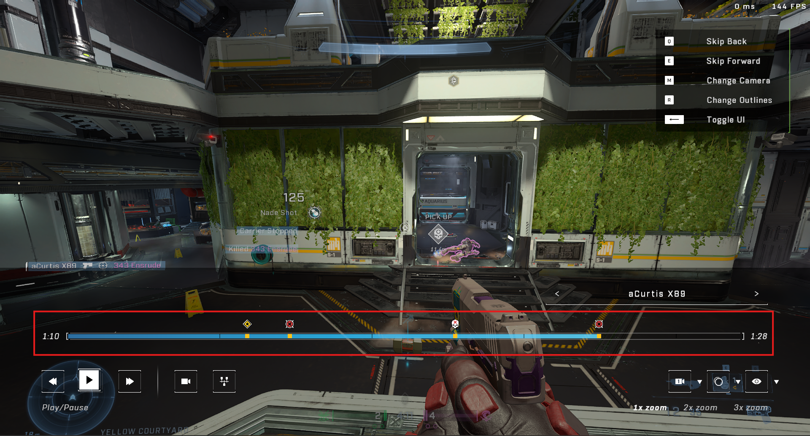

# Welcome to SPNKr

SPNKr is an async Python SDK for the undocumented Halo Infinite web API.

It is intended for personal analysis workflows (match history, skill/rank data,
metadata, and theater film parsing). The project is unofficial and provided as-is.

- Documentation: https://acurtis166.github.io/SPNKr/
- PyPI: https://pypi.org/project/spnkr/
- GitHub: https://github.com/acurtis166/SPNKr

## What You Can Do

- Request player match history, service records, and match stats.
- Retrieve skill/MMR/CSR data by match or playlist.
- Resolve player profile data (XUID <-> gamertag).
- Fetch content metadata (maps, modes, playlists, medals, season data).
- Access economy/customization-related endpoints.
- Download and parse theater film highlight events.

## Install

Requires Python >= 3.11.

```shell
pip install spnkr
```

Optional caching support (might need additional packages for specific backends):

```shell
pip install "spnkr[cache]"
```

## Quickstart

### 1. Get tokens

SPNKr requires these Halo headers:

- `x-343-authorization-spartan` (required for all endpoints)
- `343-clearance` (optional, required only for economy endpoints)

You can get them in two ways:

1. Manual (fastest): copy headers from Halo Waypoint network traffic.
1. Programmatic (recommended): use Azure app registration + refresh flow.

For detailed setup and token management strategies, see:
- [Getting Started guide](https://acurtis166.github.io/SPNKr/getting-started/) for initial setup
- [Token Providers guide](https://acurtis166.github.io/SPNKr/token-providers/) for static tokens, OAuth integration, and caching

### 2. Create the client

```python
import asyncio

from spnkr import HaloInfiniteClient


async def main() -> None:
    async with HaloInfiniteClient("SPARTAN_TOKEN") as client:
        user = await client.get_current_user()
        history = await client.get_match_history(user.xuid, start=0, count=1)
        if not history.results:
            print("No matches!")
            return

        match = history.results[0]
        map_data = await client.get_map(
            asset_id=match.match_info.map_variant.asset_id,
            version_id=match.match_info.map_variant.version_id,
        )
        mode_data = await client.get_ugc_game_variant(
            asset_id=match.match_info.ugc_game_variant.asset_id,
            version_id=match.match_info.ugc_game_variant.version_id,
        )
        match_stats = await client.get_match_stats(match.match_id)

        start_time = match.match_info.start_time.astimezone()
        total_seconds = match.match_info.duration.total_seconds()
        minutes, seconds = divmod(int(total_seconds), 60)
        print("Match Details")
        print("=============")
        print(f"  Map: {map_data.public_name}")
        print(f"  Mode: {mode_data.public_name}")
        print(f"  Started: {start_time:%m/%d/%Y, %I:%M %p}")
        print(f"  Players: {len(match_stats.players)}")
        print(f"  Outcome: {match.outcome.name}")
        print(f"  Duration: {minutes:02}:{seconds:02}")

        player_stats = next(
            p.player_team_stats[0].stats.core_stats
            for p in match_stats.players
            if p.player_id == f"xuid({user.xuid})"
        )
        print("\nStats")
        print("=============")
        print(f"  Score: {player_stats.score}")
        print(f"  Kills: {player_stats.kills}")
        print(f"  Deaths: {player_stats.deaths}")
        print(f"  Assists: {player_stats.assists}")


if __name__ == "__main__":
    asyncio.run(main())
```

### 3. Refresh tokens when needed

Spartan tokens are short-lived. If you already have replacement tokens, update an
existing client without recreating it:

```python
client.spartan_token = "NEW_SPARTAN"
```

For automated token refresh, see the [authentication reference](https://acurtis166.github.io/SPNKr/reference/authentication/) for `authenticate_player` and `refresh_player_tokens`.

# Service Overview

`HaloInfiniteClient` provides direct access to all API endpoints. Methods are grouped logically by their purpose:

| Authority | Methods | Requires Clearance? |
| --- | --- | --- |
| **Stats** | `get_match_history`, `iter_match_history`, `get_match_count`, `get_match_stats` | No |
| **Skill** | `get_match_skill`, `get_playlist_csr`, `get_service_record`, `get_challenge_decks` | No |
| **Profile** | `get_current_user`, `get_user_by_gamertag`, `get_user_by_id`, `get_users_by_id` | No |
| **Discovery UGC** | `get_map`, `get_playlist`, `get_ugc_game_variant`, `get_map_mode_pair`, `search_assets`, `get_film_by_match_id` | No |
| **Game CMS** | `get_medal_metadata`, `get_csr_season_calendar`, `get_season_calendar`, `get_career_reward_track`, `get_image`, `get_progression_file` | No |
| **Economy** | `get_player_customization`, `get_player_career_rank`, `get_player_reward_track_operations` | **Yes** |

See the [client reference](https://acurtis166.github.io/SPNKr/reference/client/) for complete details.

## Caching

SPNKr supports `aiohttp-client-cache` as a drop-in session replacement.
This can reduce repeated requests, especially for metadata-heavy workflows.

When caching localized Discovery UGC calls (for example with
`language="fr-FR"`), configure cache keys to account for language and avoid
token-specific duplication.

See the [Basic Usage](https://acurtis166.github.io/SPNKr/basic-usage/) guide for full caching guidance.

## Film / Theater Parsing

The `spnkr.film` module includes helpers for downloading film chunks and parsing
timestamped highlight events from theater recordings.

In theater mode, these highlight events appear as timeline markers for key match
moments such as kills, deaths, medals, and mode-specific events.



Here is a minimal example script to dump highlight events for a match to JSON.
Medal events include both the numeric `medal` value and its `medal_name`.

```python
import asyncio
import json

from spnkr import HaloInfiniteClient, film


async def main():
    async with HaloInfiniteClient(spartan_token="SPARTAN_TOKEN") as client:
        events = await film.read_highlight_events(client, match_id="MATCH_GUID")

    with open("highlight_events.json", "w") as fp:
        json.dump([e.model_dump(mode="json") for e in events], fp)


if __name__ == "__main__":
    asyncio.run(main())
```

See the [Film reference](https://acurtis166.github.io/SPNKr/reference/film/) for more details.

## Development

### Setup

This project uses `uv` as the package manager. Install dependencies with:

```shell
uv sync
```

### Code Quality

Before committing, run:

```shell
uv check
ruff check --fix
ruff format
```

### Testing

Run the full test suite:

```shell
uv run pytest                    # Run all tests
uv run pytest tests/unit         # Run unit tests only
uv run pytest tests/integration  # Run integration tests only
```

Unit tests run without any setup. Integration tests will be **automatically skipped** if credentials are not configured.

#### Integration Tests (Optional)

To run integration tests, create a `.env` file in the project root with:

```env
SPNKR_CLIENT_ID=your_azure_app_client_id
SPNKR_CLIENT_SECRET=your_azure_app_client_secret
SPNKR_REDIRECT_URI=https://localhost
SPNKR_REFRESH_TOKEN=your_oauth_refresh_token
```

### Documentation

Build and serve the documentation locally:

```shell
uv run mkdocs serve
```

This starts a live-reloading server at `http://localhost:8000`. To deploy documentation updates to GitHub Pages:

```shell
uv run mkdocs gh-deploy
```

This builds the docs and pushes them to the `gh-pages` branch.

### Publishing

Releases are published to [PyPI](https://pypi.org/project/spnkr/) automatically via GitHub Actions when a new release is created.

## Acknowledgements

- Xbox Live authentication flow: https://github.com/OpenXbox/xbox-webapi-python
- Halo Infinite authentication flow and endpoint research: https://den.dev/blog/halo-api-authentication
- Microsoft/Halo Studios

## Disclaimer

This software is not endorsed or supported by Microsoft or Halo Studios.
It is a personal project for Halo Infinite data analysis.

Authentication requires personal credentials and tokens; use at your own risk.

## Contributing

Contributions to fix issues or add endpoint support are welcome.
